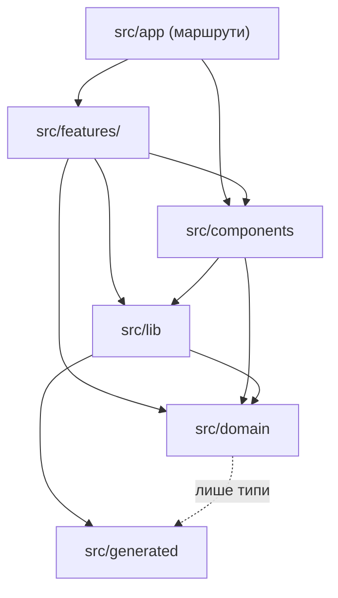
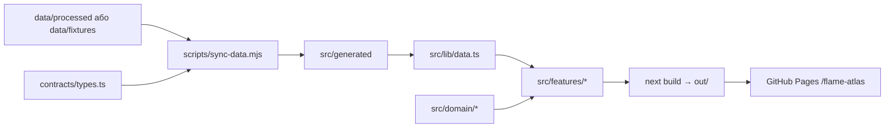

# Architecture Spine — Flame Atlas, сайт (apps/web)

## Design Paradigm

Функціональне ядро і тонка оболонка. Усі розрахунки — чисті функції; React лише показує їхній результат.

| Шар | Каталог | Що там живе | Може імпортувати |
| --- | --- | --- | --- |
| Маршрути | `src/app/` | файли маршрутів, layout, навігація | `features`, `components`, `lib` |
| Екрани | `src/features/<screen>/` | клієнтські компоненти одного екрана | `domain`, `components`, `lib` |
| Спільні компоненти | `src/components/` | презентаційні компоненти, `ui/` | `domain`, `lib` |
| Оболонка | `src/lib/` | шлюз даних, стан у URL, шляхи | `domain`, `generated` |
| Ядро | `src/domain/` | чисті функції, конфіг чисел | лише типи з `generated` |
| Згенероване | `src/generated/` | копії JSON і типів контракту | нічого |

## Invariants & Rules



Стрілка означає «може імпортувати». Зворотних стрілок немає: `domain` не знає про React, Next і `lib`; один feature не імпортує інший.

### AD-1 — Статичний експорт без серверних можливостей [ADOPTED]

- **Binds:** all
- **Prevents:** використання можливостей Next.js, яких немає на GitHub Pages; збірку, що падає перед поданням
- **Rule:** у `next.config.ts` стоять `output: "export"` і `trailingSlash: true`. Заборонено: route handlers, server actions, `cookies()` і `headers()`, проп `searchParams` у `page.tsx`, proxy, `redirects`, `rewrites` і `headers` у конфігу, ISR, `next/image` зі стандартним завантажувачем, `cacheComponents` і `partialPrefetching`, динамічні маршрути без `generateStaticParams`. Query string читають лише клієнтські компоненти. `npm run build` проходить перед кожним злиттям у `main`.

### AD-2 — Єдиний шлюз даних

- **Binds:** all
- **Prevents:** різні способи завантаження даних, дублювання типів контракту, читання файлів поза контрактом
- **Rule:** `scripts/sync-data.mjs` запускається перед `dev`, `build` і `test`. Він копіює чотири JSON-файли й `contracts/types.ts` у `src/generated/`. Джерело: `data/processed`, якщо там є всі чотири файли, інакше `data/fixtures`; змінна `DATA_SOURCE` задає джерело явно. JSON імпортує лише `src/lib/data.ts`. Типи контракту імпортуються лише з `@/generated/contract`; локальних копій типів немає. У рантаймі запитів за даними немає. Клієнтський компонент сам імпортує дані з `@/lib/data`; через пропи з серверного компонента в клієнтський передаються лише id або один запис, а не масиви даних.

### AD-3 — Розрахунки живуть у domain

- **Binds:** Scenario, Tests, Coverage, Investigations
- **Prevents:** дві реалізації однієї формули; розрахунки, які неможливо перевірити тестом
- **Rule:** бал ранжування, найближчі тести, сітка покриття, прогалини, фільтри, матриця «що змінювалось», експорт — чисті функції в `src/domain/`. Вони приймають дані аргументами й не імпортують React, Next, `window`, `lib`, `features`. Компонент не рахує нічого, крім вибору, що показати. Кожен файл domain має тест vitest поруч (`*.test.ts`).

### AD-4 — Одне джерело чисел

- **Binds:** all
- **Prevents:** різні пороги й ваги на різних екранах і на слайдах
- **Rule:** ваги ранжування, масштаби відстаней, пороги класу атмосфери (кисень ≥ 30 %, тиск ≤ 70.33 кПа, тобто 10.2 psi), типовий сценарій, межі клітинок сітки покриття лежать у `src/domain/config.ts`. Ці числа не повторюються літералами в інших файлах.

### AD-5 — Що рахується тестом

- **Binds:** all
- **Prevents:** завищення кількості тестів рядками «день тестів» і «матриця умов»
- **Rule:** `isTestRow(row)` з domain — єдина перевірка (`granularity === "test"`). Кожен лічильник зі словом «tests» рахує лише такі рядки. Рядки інших типів показуються окремим лічильником з назвою типу.

### AD-6 — Відсутнє значення

- **Binds:** all
- **Prevents:** нуль на екрані замість «не вказано»; різну поведінку екранів на неповних даних
- **Rule:** `null` не перетворюється на 0 чи порожній рядок. На екрані це текст `not reported`, який дає лише `src/domain/format.ts`. У ранжуванні складник з невідомим значенням дорівнює 0 (`UNKNOWN_COMPONENT_SCORE`) і додає застереження. Фільтр за діапазоном не включає рядки з `null`, доки користувач не ввімкне перемикач `include not reported`.

### AD-7 — Стан у адресі сторінки

- **Binds:** Scenario, Tests, Coverage, Investigations
- **Prevents:** два механізми стану; два різні розбори сценарію на екранах Scenario і Coverage; демо-посилання, що відкривають не той стан
- **Rule:** сценарій і фільтри зберігаються в query string. Сценарій спільний для екранів, тому його параметри, розбір і запис існують один раз: `parseScenario` і `buildScenarioParams` у `src/lib/url-state/scenario.ts`. Сценарій без параметрів в адресі — це `DEFAULT_SCENARIO_ID` з `src/domain/config.ts`; посилання навігації стану не переносять. Фільтри одного екрана описує файл `url.ts` у теці цього feature. Хук `useQueryState` у `src/lib/url-state/use-query-state.ts` — єдине місце, що викликає `useSearchParams` і змінює адресу. Адресу він змінює через `window.history.replaceState` з відносним рядком `?query`; повний шлях з `usePathname()` не будуємо, бо той не містить базового шляху. Глобального стора немає; `useState` лише для тимчасового стану інтерфейсу. Компонент, що читає адресу, клієнтський і загорнутий у `<Suspense>` у файлі маршруту.

### AD-8 — Простежуваність на екрані

- **Binds:** all
- **Prevents:** числа й твердження без шляху до джерела; спроби зіставити зведене поле з вихідною колонкою, чого контракт не дає
- **Rule:** кожен показаний рядок таблиці дає доступ до всього свого вихідного рядка через один компонент `<RowSource>`: `raw`, `tableFile`, `sourceRow`, `inferred`, `confidence`. Зіставлення «поле → колонка» не робимо. Твердження типу `Claim` показується лише через `<ClaimText>` разом з його `citations`.

### AD-9 — Базовий шлях

- **Binds:** all
- **Prevents:** посилання й файли, що працюють локально й ламаються під `/flame-atlas`
- **Rule:** внутрішні посилання — лише `next/link` або `useRouter`. Файли з `public/` — лише через `assetPath()` з `src/lib/paths.ts`. Рядок `/flame-atlas` існує тільки у змінній `NEXT_PUBLIC_BASE_PATH`, яку задає CI. Маршрут `/investigations/[id]` має `generateStaticParams` з усіх id і `dynamicParams = false`; порожній список id ламає збірку, тому `investigations.json` не буває порожнім. `params` у сторінці — це Promise.

### AD-10 — Feature володіє своїм екраном

- **Binds:** all
- **Prevents:** конфлікти злиття і перехресні залежності між двома розробниками
- **Rule:** `src/features/<screen>/` не імпортує інший feature. Спільне виноситься в `src/components/` або `src/domain/`. Файл маршруту в `src/app/` містить лише метадані й монтування одного feature в `<Suspense>`. Спільні файли (`config.ts`, `types.ts`, `format.ts`, `num.ts`, `data.ts`, `url-state/scenario.ts`) змінюються малими окремими комітами.

### AD-11 — Одне правило потрапляння в інтервал

- **Binds:** Tests, Coverage, Scenario
- **Prevents:** три різні числа для одного питання: у клітинці сітки, після кліку по ній у таблиці, і в знахідці на головному екрані
- **Rule:** чи потрапляє рядок в інтервал, вирішує лише `rangeMatchesInterval` з `src/domain/num.ts`: одне значення має лежати в інтервалі; з переліку значень хоча б одне; суцільний діапазон має в нього заходити; `null` дає `null` і йде в лічильник «not reported». Клітинки сітки будує `intervalsFromEdges` з `COVERAGE_AXES`. Пороги класу атмосфери є межами клітинок (перевіряє тест). Фільтри, сітка покриття й прогалини не мають власних порівнянь з межами.

### AD-12 — Спершу форма, потім реалізація

- **Binds:** all
- **Prevents:** дві різні сигнатури однієї спільної функції; два власники відстані до сценарію й тексту прогалини
- **Rule:** вхідні дані й результати функцій domain описані в `src/domain/types.ts` (`ScenarioInput`, `RankResult`, `CoverageGrid`, `Gap`, `TestFilters`, `VariableSummary`) разом з типами самих функцій. Функція domain оголошується з відповідним типом. Зміна форми — окремий малий коміт у `types.ts`, який потрапляє в `main` раніше за код, що її використовує. Відстань від сценарію до рядка рахує одна функція `conditionDistance`; речення про прогалину пише лише `describeGap`.

## Consistency Conventions

| Concern | Convention |
| --- | --- |
| Назви | файли в kebab-case (`rank-investigations.ts`); компоненти в PascalCase з іменованим експортом; функції domain — дієслова в camelCase; тести `*.test.ts` поруч з файлом |
| Дані й формати | id як у контракті; дати ISO; кисень `%`, тиск `kPa` з `psi` у дужках, потік `cm/s`; діапазон через коротке тире, перелік через `; `, наближення з `~` |
| Стан і наскрізне | стан у URL (AD-7); порожній результат показує явний порожній стан з кнопкою скидання; кольори напрямів безпеки — одна мапа в `src/lib/pillars.ts`; тексти інтерфейсу англійською, прямо в компонентах |
| Стилі й компоненти | класи Tailwind; компоненти shadcn/ui додаються через CLI в `src/components/ui` за потреби; інші UI-бібліотеки лише після запису в `docs/decisions.md` |
| Кольори й тема | компоненти беруть кольори лише з токенів у `src/app/globals.css` (`bg-bg`, `bg-surface`, `bg-surface-muted`, `text-fg`, `text-fg-muted`, `text-fg-subtle`, `border-line`, `border-line-strong`, `bg-accent text-accent-fg`, `*-warn-*`); класи палітри (`bg-white`, `text-slate-600`) дозволені тільки в `src/lib/pillars.ts`, і там кожен має пару `dark:`; новий колір — це новий токен з двома значеннями. Тема — атрибут `data-theme` на `<html>`: збережений вибір у `localStorage` (`theme`), інакше тема системи; читає й пише лише `src/lib/theme.ts`; скрипт у `<head>` ставить тему до першого кадру |
| Сканування класів | Tailwind пропускає шляхи з `.gitignore`, тому правила ігнорування прив'язуємо до кореня (`/coverage/`, а не `coverage/`): інакше папка екрана з такою назвою не потрапить ні в git, ні в стилі |
| Графіки | сітка покриття й смужки складників балу — CSS, без бібліотеки; Recharts лише якщо знадобиться справжній графік, і тоді `npm i recharts@3.10.1 react-is@19.3.0` (зі старим `react-is` він мовчки губить елементи) |
| Залежності | додає власник `main` і деплою; `package-lock.json` комітиться |

## Stack

| Name | Version |
| --- | --- |
| Node.js | 20.20.0 (інструменти потребують ≥ 20.19) |
| npm | 11.17.0 |
| Next.js (App Router, Turbopack, статичний експорт) | 16.4.6 |
| React, React DOM | 19.3.0 |
| TypeScript | 5.9.3 |
| Tailwind CSS (`@tailwindcss/turbopack`) | 4.3.3 |
| ESLint, `eslint-config-next` | 9.39.5, 16.4.6 |
| Vitest (з Vite 8.3.8) | 4.1.12 |
| Recharts разом з `react-is` (встановлювати однією командою) | 3.10.1 і 19.3.0 |
| Хостинг | GitHub Pages через GitHub Actions |

## Structural Seed



```text
apps/web/
  next.config.ts            # статичний експорт, basePath з NEXT_PUBLIC_BASE_PATH
  scripts/sync-data.mjs     # копіює дані й типи контракту в src/generated
  src/
    app/                    # маршрути: /, /tests, /coverage, /investigations, /investigations/[id], /methodology
    features/
      scenario/  tests/  coverage/  investigations/  methodology/
    components/             # ClaimText, RowSource, PillarBadge, ThemeToggle, InlineScript, ui/
    domain/                 # config, types, num, format, rows, rank, coverage, gaps, filters, variables, export
    lib/                    # data, paths, pillars, theme, url-state/ (scenario, use-query-state)
    generated/              # у .gitignore
```

Середовища: локальне (`npm run dev`, базовий шлях порожній) і GitHub Pages (`main`, базовий шлях `/flame-atlas`, адреса `https://vlo0d.github.io/flame-atlas/`). Секретів і змінних рантайму немає.

## Capability → Architecture Map

| Capability / Area | Lives in | Governed by |
| --- | --- | --- |
| Scenario: сценарій, ранжування, знахідка | `features/scenario`, `domain/rank`, `domain/gaps` | AD-3, AD-4, AD-6, AD-7, AD-11, AD-12 |
| Tests: таблиця, фільтри, експорт | `features/tests`, `domain/filters`, `domain/export` | AD-3, AD-5, AD-6, AD-7, AD-8, AD-11 |
| Coverage: сітка й прогалини | `features/coverage`, `domain/coverage`, `domain/gaps` | AD-3, AD-4, AD-5, AD-7, AD-11, AD-12 |
| Investigations: список, картка, матриця змінних | `features/investigations`, `domain/variables` | AD-8, AD-9, AD-12 |
| Methodology: джерела, якість, обмеження | `features/methodology` | AD-2, AD-8 |
| Дані | `scripts/sync-data.mjs`, `lib/data.ts`, `generated/` | AD-2 |
| Деплой | `next.config.ts`, GitHub Actions | AD-1, AD-9 |

## Deferred

- **Живий Evidence brief від LLM.** Потребує серверної функції й ключа, тобто іншого хостингу. Замість нього зроблено заготовлений SI brief для готових сценаріїв: тексти в `src/content/briefs.json` (єдиний JSON поза контрактом, імпортує його лише `src/lib/data.ts` — виняток з AD-2, записаний у `docs/decisions.md`), факти й перевірка в `src/domain/brief.ts` (AD-3, AD-12). Живий brief для власних значень лишається відкладеним.
- **Екран Compare.** Не входить у п'ять обов'язкових екранів.
- **Завантаження даних з `public/` замість бандла.** Повертаємось, якщо спільний чанк з даними перевищить близько 1.5 МБ у gzip.
- **Віртуалізація таблиці.** Поки що сторінки по 25, 50, 100 або 200 рядків (типово 50, розмір в адресі).
- **Мобільна верстка, переклади.** Не потрібні для демо.
- **Наскрізні тести й аналітика.** Тестуємо лише domain.
